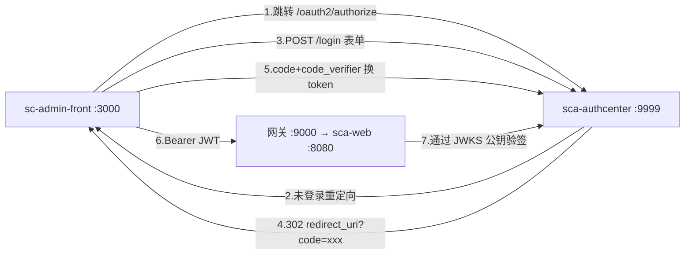

# sca-authcenter OAuth2 认证授权改造（授权码+PKCE / JWKS验签）

## 目标架构

- 授权模式：`authorization_code` + PKCE + `refresh_token`（SPA 公共客户端，无 client_secret）
- Token：JWT（RSA2048 非对称签名），authcenter 暴露 `/oauth2/jwks` 公钥端点
- 客户端/授权记录：先内存存储（InMemory），后续可升级 JDBC
- 登录页：复用前端自有登录页（authcenter formLogin 重定向到 `http://localhost:3000/login`，登录表单 POST 回 authcenter `/login`）

## Task 1：父 POM 增加依赖管理

[pom.xml](file:///e:/project/opensabre/springalibabadmin/SpringCloudAdmin/pom.xml) 增加：
- `<spring-security-oauth2-authorization-server.version>1.2.4</spring-security-oauth2-authorization-server.version>`（与 Boot 3.2.4 对齐）
- dependencyManagement 中增加 `spring-security-oauth2-authorization-server` 条目

## Task 2：sca-authcenter 模块实现

**pom.xml 重写**：移除不可用的 `spring-cloud-starter-oauth2`，改为：
- `sca-config`、`sca-common`、`sca-security`（复用其 `UserDetailsServiceImpl` 与 sys_user 查询）
- `spring-security-oauth2-authorization-server`、nacos-discovery、web、mysql-connector、mybatis 数据源（参照 sca-web 依赖集）

**新增类**（包 `com.opensabre.admin.authcenter`）：
- `ScaAuthcenterApplication`：启动类，`@ComponentScan` 覆盖 `com.opensabre.admin.authcenter` 与 `com.opensabre.admin.security.service`（加载 UserDetailsServiceImpl）
- `config/AuthorizationServerConfig`：
  - `@Bean authorizationServerSecurityFilterChain`（标准模板）
  - `RegisteredClientRepository`（InMemory）：注册客户端 `sc-admin-front`，grant types = authorization_code / refresh_token，`requireProofKey(true)`，`requireAuthorizationConsent(false)`，redirect-uri = `http://localhost:3000/oauth2/callback`
  - `JWKSource`：启动时生成 RSA KeyPair（参考 tulingmall 的 jwt.jks 思路，改为代码生成，注释说明企业应用 JKS/环境变量密钥）
  - `AuthorizationServerSettings`：issuer = `http://localhost:9999`
  - `OAuth2TokenCustomizer<JwtEncodingContext>`：将 UserDetails 的角色/权限写入 JWT claims（`roles`、`permissions`），对齐 [UserDetailsServiceImpl](file:///e:/project/opensabre/springalibabadmin/SpringCloudAdmin/sca-security/src/main/java/com/opensabre/admin/security/service/UserDetailsServiceImpl.java) 的权限结构
- `config/DefaultSecurityConfig`：formLogin 链，`loginPage("http://localhost:3000/login")`，`DaoAuthenticationProvider` + `UserDetailsServiceImpl` + `BCryptPasswordEncoder`，csrf 禁用（跨域 SPA 场景，注释说明企业应启用）

**配置文件**：
- `application.yml`：port 9999、`spring.application.name: sca-authcenter`、`spring.autoconfigure.exclude: com.opensabre.admin.security.config.SecurityConfig`（排除资源服务器自动配置）、`mysql.db: sca_db`
- `bootstrap.yml`：参照 [sca-web/bootstrap.yml](file:///e:/project/opensabre/springalibabadmin/SpringCloudAdmin/sca-web/src/main/resources/bootstrap.yml)（Nacos 注册 + 共享配置 sca-common.yml）

## Task 3：sca-security 改造为 JWKS 资源服务器模式

- **pom.xml**：移除 jjwt 依赖，增加 `spring-boot-starter-oauth2-resource-server`
- **SecurityConfig**：SecurityFilterChain 改为 `.oauth2ResourceServer(oauth2 -> oauth2.jwt(...))`，移除 `JwtAuthenticationFilter` 挂载；新增 `JwtAuthorityConverter`（从 claims `roles`/`permissions` 还原 GrantedAuthority，principal=sub）
- **删除**：`JwtTokenProvider`、`JwtAuthenticationFilter`、`LoginRequest`、`RefreshTokenRequest`、`LoginResponse`、`RefreshTokenResponse`
- **SecurityProperties**：移除 `jwt`/`renewal` 段，仅保留 `permitUrls`
- **AuthController**：删除 `/login`、`/refresh`；保留 `/register`；`/info` 改为基于 `@AuthenticationPrincipal Jwt` 从 claims 读取用户名/角色/权限（返回结构不变，前端无感）

## Task 4：sca-web 配置适配

[application.yml](file:///e:/project/opensabre/springalibabadmin/SpringCloudAdmin/sca-web/src/main/resources/application.yml)：
- 删除 `security.jwt` / `security.renewal` 段
- 增加 `spring.security.oauth2.resourceserver.jwt.issuer-uri: http://localhost:9999`
- `permit-urls` 移除 `/api/auth/login`、`/api/auth/refresh`（保留 register、hotel 等）
- 检查 sca-order / sca-stock 是否引用 sca-security，如有则同步配置

## Task 5：前端 sc-admin-front 改造（OAuth2 重定向流程）

- **vite.config.ts**：新增 `/authcenter` 代理 → `http://localhost:9999`（路径重写去掉前缀）
- **utils/pkce.ts**（新增）：Web Crypto 生成 code_verifier / code_challenge(S256)
- **views/login/index.vue**：登录按钮改为发起 OAuth2 授权跳转（生成 verifier/state 存 sessionStorage，`window.location` 跳转 `/authcenter/oauth2/authorize?response_type=code&client_id=sc-admin-front&redirect_uri=...&code_challenge=...&code_challenge_method=S256`）
- **views/oauth2/callback.vue**（新增）+ 路由：读取 `code`，携带 `code_verifier` POST `/authcenter/oauth2/token`（form-urlencoded），保存 accessToken/refreshToken 后跳首页
- **stores/user.ts**：`login()` 改为 `startOAuthLogin()`；`getUserInfo()` 保持
- **utils/request.ts**：401 刷新逻辑改为调 `/authcenter/oauth2/token`（`grant_type=refresh_token`，标准 OAuth2 响应格式）；移除滑动窗口响应头续期逻辑
- **utils/auth.ts**：保留，token 键不变

## Task 6：网关与验证

- 网关 `AuthGlobalFilter` 仍为 TODO 占位，本次不实施网关层验签（资源服务各自验签已闭环），仅更新放行路径注释
- 编译验证：`mvn compile` 覆盖 sca-authcenter / sca-security / sca-web / sca-order / sca-stock
- 端到端验证：启动 authcenter + sca-web + 前端，走一遍 登录→回调→拿token→访问 /api/auth/info→刷新token→退出 全流程

## 风险与说明

- authcenter 与前端登录页跨端口交互依赖 session cookie（同 localhost 域，经 vite 代理保持同源），本地联调无问题；生产部署建议网关统一入口
- 客户端信息与授权记录使用内存存储，服务重启后已发授权失效（token 本身仍可验签通过）；如需持久化后续可加 Authorization Server JDBC schema
- CSRF 禁用仅限本演示环境，已在代码注释标明企业做法